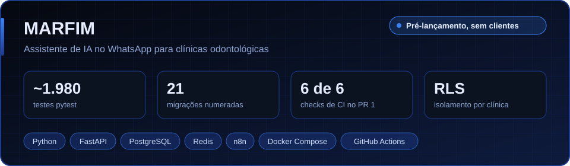
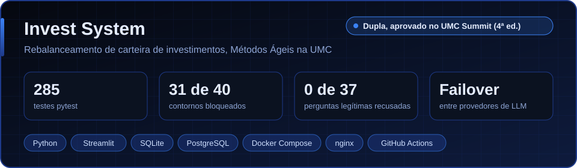
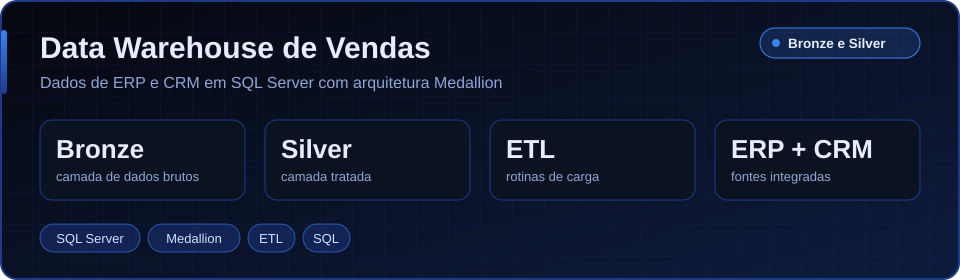

 

**Escrevo backend em Python e só confio no que passa nos testes.**
Estudante de Engenharia de Software na UMC, com foco em isolamento de dados, segurança e IA com limites claros.

## Agora

<table>
<tr>
<td width="50%" valign="top">

**Construindo**
- MARFIM, SaaS de assistente virtual para clínicas odontológicas, em pré-lançamento
- Testes e segurança como parte de cada entrega
- Apresentações públicas dos projetos privados

</td>
<td width="50%" valign="top">

**Buscando**
- Estágio em desenvolvimento backend, dados ou infraestrutura
- Time que revise código por Pull Request e trate teste como parte do trabalho

</td>
</tr>
</table>

## Projetos

SaaS multiempresa com agenda própria, painel do operador, equipe com papéis, consentimento versionado e API por clínica. Uma falha de gravidade Alta foi encontrada em revisão de segurança interna e corrigida. Tudo validado por simulação e testes, ainda sem clientes. O código é privado e a apresentação fica em [marfim-showcase](https://github.com/gabrielnagatanicampos/marfim-showcase).

Projeto próprio que ganhou outra proporção ao ser integrado à disciplina de Métodos Ágeis da UMC, em dupla, onde atuei como Product Owner. Isso trouxe atualizações, alertas por e-mail e a subida para uma VPS com auxílio do professor. Scrum com sprints semanais, Definition of Done e revisão por Pull Request. A defesa contra prompt injection tem várias camadas, e o chat com os provedores de LLM foi testado com cliente simulado. Apresentação em [invest-system-showcase](https://github.com/gabrielnagatanicampos/invest-system-showcase).

Repositório público com as camadas Bronze e Silver da arquitetura Medallion para dados de ERP e CRM. A camada Gold não foi feita. Código em [DataWarehouse](https://github.com/gabrielnagatanicampos/DataWarehouse).

Também no GitHub: [gameboxd](https://github.com/gabrielnagatanicampos/gameboxd), diário de jogos em Flutter feito na faculdade. Fui Scrum Master do UniFind, aprovado para a revista científica na 3ª edição do UMC Summit.

## Como trabalho

1. **Teste primeiro.** A regra de negócio entra junto com o teste. No MARFIM, o CI roda pytest, bandit, gitleaks e pip-audit a cada Pull Request.
2. **Revisão por Pull Request.** Mudança passa por revisão e por checagens verdes antes de ser considerada pronta.
3. **Segurança desde o desenho.** Isolamento por clínica no banco, trilha de auditoria e relatórios de segurança, com os achados corrigidos e os abertos documentados.
4. **IA declarada.** Uso o Claude Code nos meus projetos, com critérios de aceite escritos antes, revisão do que ele produz e testes que provam o resultado.

## Stack

 

 

## Formação e certificações

- **Engenharia de Software**, UMC, 2025 a 2028
- **Técnico em Administração**, Etec São Sebastião, 2023 a 2024
- CPA 20 (ANBIMA)
- Fundamentos de Python para Análise de Dados, Data Science e ML
- IA e Análise de Dados, Finance TechBoost (80h)
- Curso do Banco do Brasil: estruturas de dados, SQL e NoSQL, Big Data e Python
- Projetos de Sistemas de TI, Fundação Bradesco
- Inglês B1

## Contato

