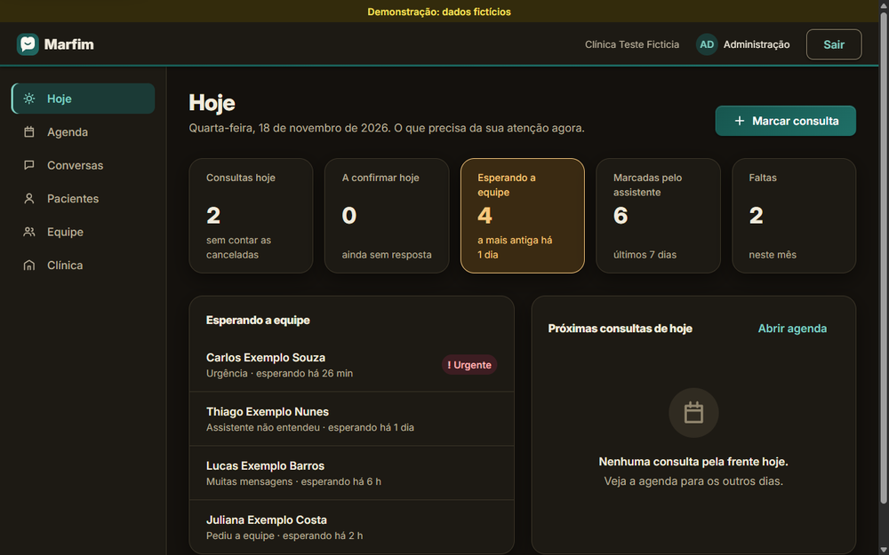
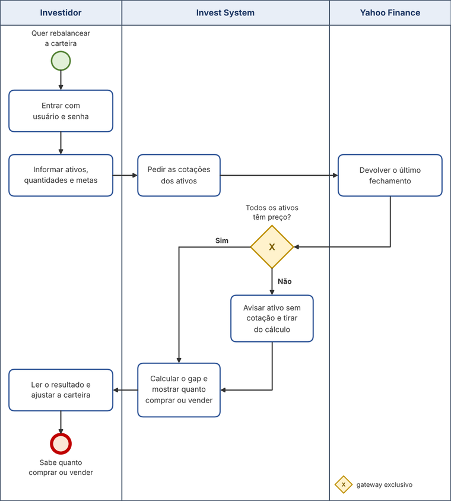
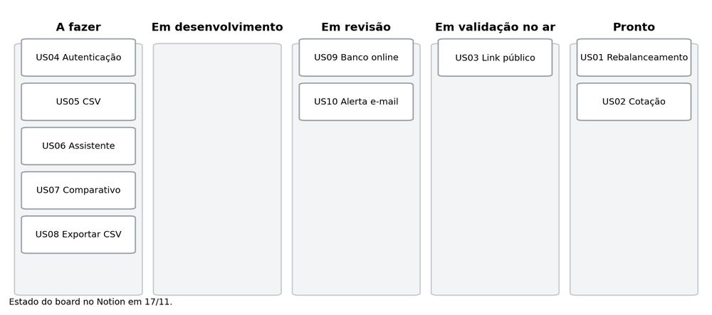

## Sobre

Estudo Engenharia de Software na UMC e gosto de transformar uma dúvida de negócio em dado, requisito e entrega.
Levanto requisitos, modelo dados em SQL, escrevo critérios de aceite e conduzo o time com Scrum (Scrum Master no UniFind, Product Owner no Invest System).
Boa parte do código foi construída com apoio de IA generativa; eu defino requisitos e reviso.

## Agora

<table>
<tr>
<td width="50%" valign="top">

**Construindo**
- MARFIM, assistente virtual para clínicas odontológicas, em pré-lançamento
- Data Warehouse de Vendas em SQL Server (camadas Bronze e Silver)
- Invest System, evoluindo a cada sprint

</td>
<td width="50%" valign="top">

**Buscando**
- Estágio em dados, análise de requisitos ou gestão ágil
- Time que me deixe praticar SQL e Scrum no dia a dia

</td>
</tr>
</table>

## Projetos em destaque

<table>
<tr>
<td width="46%" valign="top">

</td>
<td width="54%" valign="top">

### MARFIM
*Pré-lançamento, ainda sem clientes. Antes chamado Nexus.*

Assistente virtual para clínicas odontológicas, com agenda, pacientes, conversas e equipe. Cada clínica enxerga só os próprios dados. Validado por simulação e testes.

`Python` `FastAPI` `PostgreSQL` `n8n`

[Ver apresentação](https://github.com/gabrielnagatanicampos/marfim-showcase)

</td>
</tr>
<tr>
<td width="46%" valign="top">

</td>
<td width="54%" valign="top">

### Invest System
*Selecionado para a 4ª edição do UMC Summit, categoria Inovação.*

Projeto próprio, iniciado antes da disciplina de Métodos Ágeis (UMC) e levado a ela para ampliar funcionalidades, ganhar visão de negócio, ir para a internet e praticar Scrum. Rebalanceamento de carteira com cotações reais. Atuei como Product Owner, em dupla. Suíte de testes automatizados gerada com apoio de IA e revisada por mim.

`Python` `Streamlit` `SQL` `Scrum`

[Ver apresentação](https://github.com/gabrielnagatanicampos/invest-system-showcase)

</td>
</tr>
<tr>
<td width="46%" valign="top">

</td>
<td width="54%" valign="top">

### Gestão ágil na prática
Sprints semanais, backlog de histórias, Definition of Done, Kanban com limite de trabalho em andamento e, como regra do time, Pull Request revisado por outro integrante.

</td>
</tr>
<tr>
<td width="46%" valign="top" align="center">
  

`Bronze` → `Silver`

</td>
<td width="54%" valign="top">

### Data Warehouse de Vendas
SQL Server com arquitetura Medallion e rotinas de ETL para dados de ERP e CRM. Camadas Bronze e Silver prontas.

`SQL Server` `T-SQL` `ETL`

[Ver código](https://github.com/gabrielnagatanicampos/DataWarehouse)

</td>
</tr>
</table>

Também: [gameboxd](https://github.com/gabrielnagatanicampos/gameboxd), diário de jogos em Flutter feito na faculdade. UniFind: fui Scrum Master e escrevi requisitos e documentação técnica; aprovado para a revista científica na 3ª edição do UMC Summit.

## Habilidades

**Dados** 

**Requisitos e Gestão** 

**Backend** 

## Formação e certificações

- **Engenharia de Software**, UMC, 2025 a 2028
- **Técnico em Administração**, Etec São Sebastião, 2023 a 2024
- CPA 20 (ANBIMA)
- Fundamentos de Python para Análise de Dados, Data Science e ML
- IA e Análise de Dados, Finance TechBoost (80h)
- Curso do Banco do Brasil: estruturas de dados, SQL e NoSQL, Big Data e Python
- Projetos de Sistemas de TI, Fundação Bradesco
- Inglês B1

## Contato

